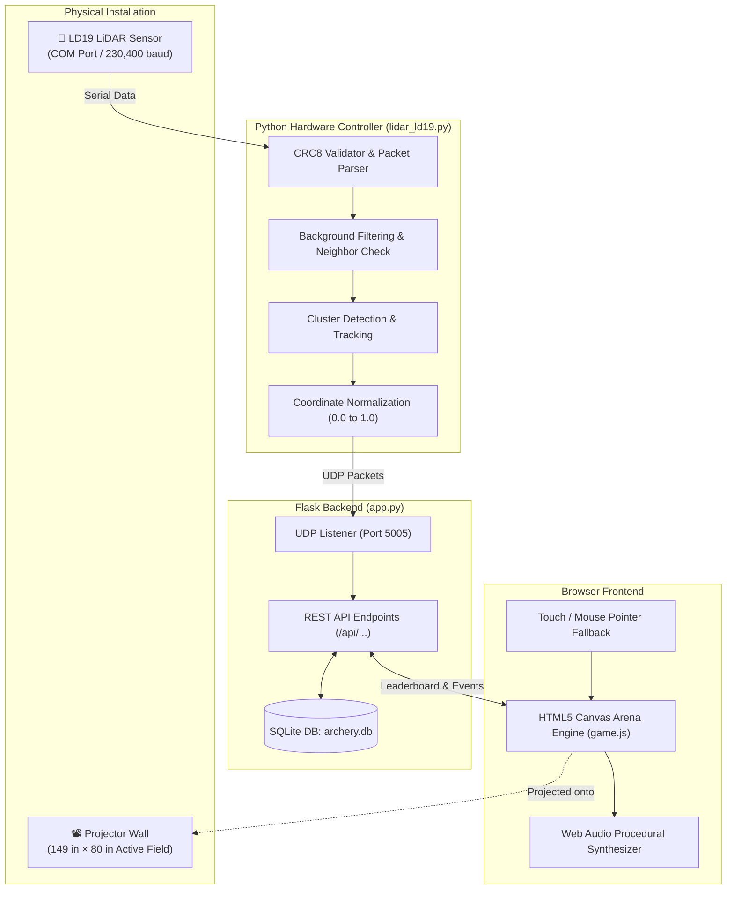

# 🎯 Olympic Archery Arena

<p align="center">
  
</p>

<p align="center">
  <a href="#-features"></a>
  <a href="#-hardware--lidar-integration"></a>
  <a href="https://flask.palletsprojects.com/"></a>
  <a href="#-quick-start"></a>
  <a href="LICENSE"></a>
</p>

---

## 📖 Overview

**Olympic Archery Arena** is a full-featured, stadium-style interactive archery simulation and sports entertainment system. Built for both **standard browser/touchscreen play** and **large-scale interactive projection walls** (e.g., 149" × 80" physical target surfaces), it bridges web technologies with physical hardware tracking.

The system features real-time projectile/touch detection using an **LD19 LiDAR sensor**, procedural synthesizer audio, dynamic camera transitions, responsive canvas geometry without letterboxing, and an Olympic-grade scoring engine with a persistent SQLite Hall of Fame.

---

## ✨ Features

- 🏹 **Authentic Olympic Scoring Rules**:
  - **3 Targets · 12 Arrows Total** (4 arrows per target).
  - **Best 3 Count**: The lowest shot on each target is dropped, scoring a maximum of 90 points.
  - **10-Second Shot Clock**: Enforces tournament pressure with visual timers and auditory warning ticks.
  - **3-Second Staged Countdown**: Seamless target transitions with countdown announcements.
- ⚡ **Dual Input Modes**:
  - **Standalone Mode**: Play immediately in any modern web browser via mouse, trackpad, or touchscreen.
  - **Interactive Wall Mode**: Connect an **LD19 LiDAR sensor** over USB/Serial to detect real ball throws, suction arrows, or hand touches across a projected wall.
- 📐 **Full-Width Adaptive Canvas (No Black Bars)**:
  - Custom geometric engine maintains true circular targets across any viewport or projector aspect ratio without letterboxing or distortion.
- 🎵 **Built-In Procedural Web Audio Engine**:
  - Synthesizes bow releases, arrow whooshes, target impacts, countdown beeps, crowd ambience, and a gold-medal fanfare purely in code (no external MP3/WAV downloads required).
- 🏆 **Persistent Hall of Fame Leaderboard**:
  - Powered by SQLite with Write-Ahead Logging (WAL) for concurrency.
  - Real-time ranking with tie-breakers (Total Score ➜ Perfect 10s ➜ Accuracy % ➜ Timestamp).
  - Filterable by difficulty: **Rookie (Easy)**, **Contender (Medium)**, and **Champion (Hard)**.
- 🛡️ **Operator Controls & Calibration**:
  - PIN-protected admin modal (`ARCHERY_ADMIN_PIN`) for resetting leaderboard records.
  - Interactive LiDAR calibration grid toggle directly on the stadium canvas.

---

## 🏛️ System Architecture



---

## 📸 Interface Showcase

### 1. Stadium Hero & Registration
> The entry portal featuring difficulty selection (Rookie, Contender, Champion), practice mode, and session setup.


---

### 2. Live Olympic Target Range
> Full-screen stadium canvas with dynamic target transitions, 10-second shot timer, arrow impact markers, and real-time shot trackers.


---

### 3. Hall of Fame & Leaderboard
> Real-time ranking with difficulty filters, hit-rate statistics, timestamped records, and operator reset security.


---

## 📂 Project Structure

```text
olympic_archery/
├── app.py                   # Flask server, REST API, SQLite database & UDP receiver
├── lidar_ld19.py            # LD19 LiDAR driver, background subtractor & calibration UI
├── requirements.txt         # Python dependencies (Flask, pyserial)
├── archery.db               # SQLite database file (auto-initialized on first run)
├── .env.example             # Template for configuration & admin security PIN
├── .gitignore               # Clean ignore list (virtual environments, databases, cache)
├── LICENSE                  # MIT Open Source License
├── README.md                # Project documentation
│
├── static/
│   ├── game.js              # Complete stadium simulation, canvas renderer & audio engine
│   └── style.css            # Dark athletic arena styling, HUD, modals & animations
│
├── templates/
│   └── index.html           # Single-page application structure & operator modals
│
├── scripts/
│   ├── setup.bat            # One-click Windows virtual environment installer
│   ├── run_arena.bat        # Launch the Flask web game server
│   └── run_lidar.bat        # Launch the LD19 LiDAR tracking controller
│
└── docs/
    └── screenshots/         # UI previews, diagrams and visual assets
```

---

## 🚀 Quick Start Guide

### Prerequisites
- **Python 3.10+** installed and added to your system `PATH`.
- A modern web browser (Google Chrome, Microsoft Edge, Firefox, or Safari).

---

### Option A: Quick Launch on Windows (Using Scripts)

1. **Install dependencies**:
   Double-click `scripts\setup.bat` (or run it from PowerShell/CMD).
2. **Start the Web Game**:
   Double-click `scripts\run_arena.bat`.
3. **Open the Arena**:
   Navigate to [http://localhost:5000](http://localhost:5000) in your browser.

---

### Option B: Manual Setup (Cross-Platform: Windows, macOS, Linux)

1. **Clone or navigate to the repository**:
   ```bash
   git clone <REPO_URL>
   cd olympic_archery
   ```

2. **Create and activate a virtual environment**:
   - **Windows (PowerShell)**:
     ```powershell
     python -m venv .venv
     .\.venv\Scripts\Activate.ps1
     ```
   - **macOS / Linux**:
     ```bash
     python3 -m venv .venv
     source .venv/bin/activate
     ```

3. **Install dependencies**:
   ```bash
   pip install -r requirements.txt
   ```

4. **Launch the Flask application**:
   ```bash
   python app.py
   ```

5. **Play**: Open `http://localhost:5000` in your web browser. Press **F11** for an immersive full-screen experience!

---

## 📡 Hardware & LiDAR Integration (Optional)

To convert any flat wall into a massive interactive target using an **LD19 360° LiDAR**:

```
+-------------------------------------------------------------+
|                     149" Projection Wall                    |
|  [Target 1]               [Target 2]            [Target 3]  |
|                                                             |
|                          (Laser Plane)                      |
| <=========================================================> |
|                 📡 LD19 LiDAR Sensor (COM7)                 |
+-------------------------------------------------------------+
```

1. **Mounting**: Place the LD19 LiDAR sensor centered at the base or top of your projected area (default `Y = 38"` above floor level).
2. **Configure LiDAR Settings**:
   Open `lidar_ld19.py` and adjust the serial port for your system (e.g., `PORT = "COM7"` on Windows or `PORT = "/dev/ttyUSB0"` on Linux).
3. **Run the LiDAR Controller**:
   ```bash
   python lidar_ld19.py
   ```
4. **Calibrate**:
   - Use the Tkinter calibration window to capture the background wall profile (press `Capture Background`).
   - Open the web interface at `http://localhost:5000`, click **⚙ Operator**, and check **Enable LD19 Input**.
   - Throw a soft ball, shoot suction arrows, or tap the wall to trigger instant on-screen impacts!

---

## ⚙️ Configuration & Environment Variables

You can configure the application using environment variables or a `.env` file:

| Variable | Default | Description |
|---|---|---|
| `ARCHERY_ADMIN_PIN` | `2468` | Operator PIN required to reset the Hall of Fame records |
| `ARCHERY_LIDAR` | `0` | Set to `1` to run the embedded UDP receiver inside the Flask process |
| `PORT` | `5000` | Port for the web application server |
| `FLASK_ENV` | `production` | Running environment mode (`development` / `production`) |

---

## 📡 REST API Reference

The backend exposes a JSON REST API:

### `GET /api/leaderboard`
Retrieve ranked leaderboard scores.
- **Parameters**: `level` (`all`, `easy`, `medium`, `hard`)
- **Response**:
  ```json
  {
    "entries": [
      {
        "id": 1,
        "player": "Robin_Hood",
        "level": "hard",
        "total": 90,
        "accuracy": 100.0,
        "tens": 9,
        "created_at": "2026-11-10T15:00:00+00:00"
      }
    ],
    "sessions": 248
  }
  ```

### `POST /api/score`
Submit scores upon completion of 3 targets.
- **Body**:
  ```json
  {
    "player": "ArcherX",
    "level": "medium",
    "rounds": [
      [10, 10, 9, 8],
      [10, 9, 9, 7],
      [10, 10, 10, 8]
    ]
  }
  ```

### `GET /api/input-events`
Fetch real-time LiDAR hit events for low-latency web synchronization.
- **Parameters**: `after` (sequence number)

### `POST /api/admin/reset`
Wipe the Hall of Fame database (protected by operator PIN).
- **Body**: `{"pin": "2468"}`

---

## 🎯 Scoring & Difficulty Levels

| Difficulty | Target Size | Challenge Profile | Scoring Rule |
|---|---|---|---|
| **Rookie (Easy)** | Radius: 184px | Beginner athletes, casual events, younger players | Best 3 of 4 shots count per target |
| **Contender (Medium)** | Radius: 174px | Standard competition, balanced hit windows | Best 3 of 4 shots count per target |
| **Champion (Hard)** | Radius: 162px | Precision tournament target for elite marksmen | Best 3 of 4 shots count per target |

- **Rings**: Gold (10 / 9), Red (8 / 7), Blue (6 / 5), Black (4 / 3), White (2 / 1), Miss (0).
- **Maximum Possible Score**: 90 points (3 targets × 30 max points per target).

---

## 🛠️ Troubleshooting

- **No sound playing?**
  Click the **♫ SOUND** button in the top navigation bar. Browsers require a user interaction before allowing audio playback.
- **LiDAR COM port error?**
  Verify your device is plugged in via Device Manager (Windows) and update `PORT = "COM..."` in `lidar_ld19.py`.
- **Fullscreen mode?**
  Click **⛶ Fullscreen** in the navigation bar or press `F11` in your browser.

---

## 📄 License

This project is open-source under the [MIT License](LICENSE). You are free to use, modify, and distribute it for personal, educational, or commercial installations.
